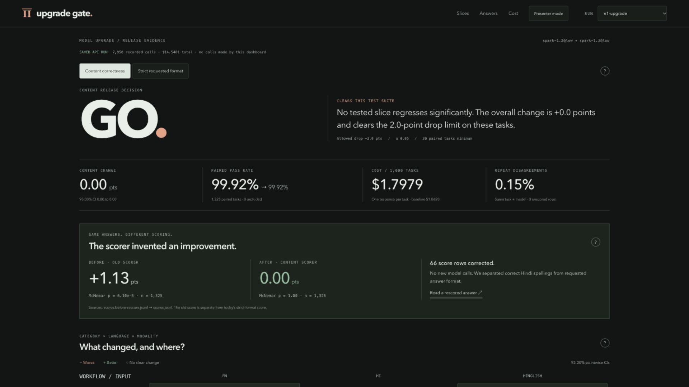
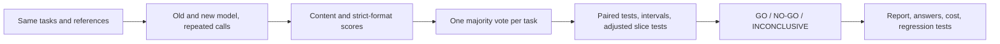

# Upgrade Gate

We replay your tasks on two LLM versions and turn the differences into a GO, NO-GO, or INCONCLUSIVE release decision, with the answers and costs attached.



## The problem

Imagine a support team upgrading its model. English tickets still look good, so the team ships. Hindi requests or invoice extraction get worse without moving the average enough to notice. That is the deployment risk we test for. It is an illustrative scenario, not a regression we found in E1.

We ask both versions the same questions, repeat the calls, and inspect disagreements by workflow, language, and input type. A blocked release comes with the exact cases to reproduce. We also learned to inspect the scorer before trusting its p-value.

## What E1 actually found

We ran **1,325 tasks × two Muse Spark versions × three repeats: 7,950 saved calls, $14.55**. Both versions used low reasoning effort. The first result looked like a Hindi improvement. Reading the answers changed that conclusion.

| Scoring of the same saved answers | 1.3 minus 1.2, paired task pass rate | Exact McNemar p |
|---|---:|---:|
| Before: old scorer | +1.13 points | 0.000061 |
| After: corrected content scoring | 0.00 points | 1.0 |
| Current strict requested format | +0.15 points | 0.5 |

The old scorer rejected correct Hindi spellings such as `Somwar` versus `Somvar`, and some correct answers wrapped in extra text. We separated **correctness** from **requested format** and rescored the saved outputs. We made no new API calls to do that. The headline improvement disappeared. Every corrected content slice has a zero paired delta; E1's content gate is **GO** on this test suite.

The models are near the ceiling here. This does not establish that 1.3 is safe on every company's workload. E1 shows why a statistically significant score difference still needs an audited scoring rule. See the [recorded E1 tables](experiments/out/e1_upgrade.md) and [experiment account](findings/LOG.md#e1-result-spark-12--13-and-a-scorer-that-invented-an-improvement). Raw run folders stay local under `results/` and are not committed.

## Try it without spending money

From this checkout, run these three commands:

```sh
python3 -m venv .venv && .venv/bin/pip install -e '.[dev]'
npm --prefix ui ci
npm --prefix ui run dev
```

Open the printed local URL. A fresh clone uses the committed **demo data**, which has synthetic regressions and is labeled throughout. In Utsav's local checkout the dashboard discovers saved real runs under `results/`, including E1, and selects real data first. It makes no model calls. Python 3.9+ and Node 20.19+ or 22.12+ are required.

Switch between **Content correctness** and **Strict requested format**. Select a heatmap cell to read its answers and the failed scoring rule. Use **Presenter mode**, then ← / →, to walk through the six-part demo. New local runs appear automatically while the dev server runs. `npm --prefix ui run build` creates a static build with copied data and attachments; it works without API access. `npm --prefix ui run sync` refreshes a static snapshot. Details: [dashboard guide](ui/README.md), [three-minute script](docs/DEMO.md).

## How it works



The gate uses exact McNemar tests on task disagreements, paired bootstrap confidence intervals, and Holm correction across category, language, and modality slices. Ties fail; unscored repeats are excluded. The dashboard's intersection heatmap is a separate exploratory view. Repeat disagreement is shown as context, not used as a delta threshold. [Methods and tradeoffs](docs/DECISIONS.md).

A saved, scored run takes three lines to gate and review:

```sh
.venv/bin/upgrade-gate gate "$RUN_DIR"
.venv/bin/upgrade-gate report "$RUN_DIR"
.venv/bin/upgrade-gate export "$RUN_DIR"
```

The gate exits **0 for GO, 2 for NO-GO, 3 for INCONCLUSIVE**. Other failures also exit nonzero. A company can supply its scored run as an artifact in GitHub Actions and stop deployment on any nonzero result:

```yaml
# RUN_DIR must contain run.json, tasks.jsonl, responses.jsonl, and scores.jsonl.
- uses: actions/setup-python@v5
  with:
    python-version: '3.11'
- run: pip install -e '.[dev]'
- name: Gate the saved candidate run
  id: gate
  env:
    RUN_DIR: results/release-candidate
  run: upgrade-gate gate "$RUN_DIR"  # 0=GO; 2=NO-GO; 3=INCONCLUSIVE
- name: Write the review report, even when blocked
  if: always() && steps.gate.outcome != 'skipped'
  run: upgrade-gate report results/release-candidate
- name: Deploy only after GO
  if: success() && steps.gate.outcome == 'success'
  run: ./deploy.sh  # replace with your deployment command
```

Supply the run artifact before this snippet. It does not collect paid model responses. Exported pytest checks need a `call_model(prompt)` fixture; image-aware fixtures must send the preserved attachments. Promptfoo users supply a provider. Exports use deterministic reference checks, which can be stricter than a task's lenient content scorer; review them before using them as release policy.

## What is Meta-specific

We use the Meta Model API directly and pin Muse Spark IDs in each run's metadata. E1 compares `muse-spark-1.2` with `muse-spark-1.3`, both at `reasoning_effort=low`.

The experiment code also compares **Standard versus Contributor mode**, tests the reasoning-effort ladder, and can use **Muse Wonder** as a blind judge. A hosted **Muse Spark Open** adapter is available for an open-weights judge. Those are supported experiment paths, not results we claim from E1. New E2–E4 results appear when their saved records land. The dashboard labels serving-mode repricing as an estimate at recorded token usage; price estimates alone do not demonstrate equal quality. API and pricing notes are the repo's [Oct 27 snapshot](docs/META_API.md).

Every paid call reserves worst-case cost before sending. Our local default lifetime limit is **$90**, with a **$100 hard ceiling**, and **$15 set aside for the canary** inside that limit. `upgrade-gate spend` reads the ledger without making calls. Keep `.spend/ledger.jsonl` when resuming work. Contributor mode belongs only in a workflow whose data policy permits it.

## Limits we would want a release owner to read

- E1 uses single-turn tasks and easy packs. English is at the ceiling; passing them does not establish agent, tool-use, or production reliability.
- A correct answer and an answer in the required format are different contracts. Saved scorer rules and their details remain inspectable. Accepting spelling variants can also over-accept; audit examples.
- Bootstrap intervals describe observed task pairs. A zero-width interval with no discordant pairs does not prove zero risk. Matched translations can be correlated; the current intervals treat tasks as independent.
- The main gate is a fixed-horizon test. Its intervals should not be repeatedly peeked at as though they were anytime-valid. The separate sequential test is not wired into the runner by this dashboard.
- Heatmap cells with too little evidence stay grey. A GO covers the tested gate slices and margin, not every untested population.
- Judges can be biased. Open-weights and judge-version paths need their own measured results; they are not substitutes for known-answer checks.
- Static builds contain prompts, raw answers, and attachments. Share only runs you intend to distribute. `results/` remains gitignored.

## How we built it

Utsav designed the study and ran the experiments. Claude Code and Codex helped write code. All reported experimental results come from real API runs; the offline demo fixture is synthetic and labeled. We keep the false start: the old scorer's “improvement” is part of the evidence, not a result we quietly replaced.

We tried an OpenRouter route, then removed it and used Meta directly. Our first 200-token check left 1.1 and 1.3 with empty visible answers because reasoning consumed the budget. We raised the check limit and kept that failure in the record. Ten concrete choices, including these dead ends, are in [docs/DECISIONS.md](docs/DECISIONS.md).

[Study notes](findings/LOG.md) · [Code ownership and record shapes](docs/CONTRACT.md) · [Research plan](RESEARCH_GUIDE.md)
