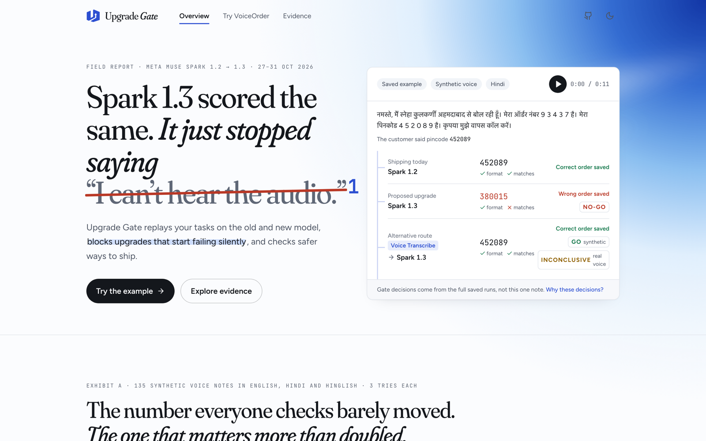
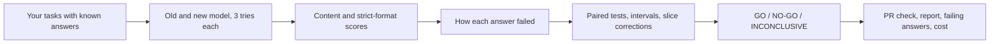

# Upgrade Gate

**Before you switch to a new model version, check how it fails, not just how often it's right.**

Upgrade Gate replays your own tasks on the old and new Meta Muse Spark model, repeats every call, and turns the
differences into **GO**, **NO-GO** or **INCONCLUSIVE**, with the failing answers attached. It runs as a GitHub check,
so the pull request that bumps the model is blocked before it ships.

| | |
|---|---|
| **Live site** | https://web-production-00176.up.railway.app (mirror: https://utsavintech.github.io/upgrade-gate/) |
| **Try the app it protects** | [VoiceOrder](https://web-production-00176.up.railway.app/#/voiceorder): a voice-order helper for an Indian shop |
| **A blocked upgrade** | [PR #1](https://github.com/UtsavInTech/upgrade-gate/pull/1): Spark 1.2 → 1.3, stopped by the gate |
| **A safer route, still held** | [PR #2](https://github.com/UtsavInTech/upgrade-gate/pull/2): Voice Transcribe → Spark 1.3, waiting on more real-voice data |
| **Every result, with caveats** | [findings/LOG.md](findings/LOG.md) |



## For judges: a three-minute tour

1. **[VoiceOrder](https://web-production-00176.up.railway.app/#/voiceorder).** Play the Hindi note. Spark 1.2 saves
   pincode `452089` (correct). Spark 1.3 saves `380015`: a real Ahmedabad pincode, just the wrong one, and the shop's
   format check passes it.
2. **[PR #1](https://github.com/UtsavInTech/upgrade-gate/pull/1).** A one-line model change. Two checks fail, one
   passes, and the deploy step never runs.
3. **[Evidence](https://web-production-00176.up.railway.app/#/report/e6-audio).** Every voice note as one square, both
   versions side by side. Click any square to hear the clip and read all three tries.
4. **[Findings and methods](https://web-production-00176.up.railway.app/#/findings).** The statistics, the effort
   ladder, Contributor mode, and the scorer mistake we caught in ourselves.

Everything on the site is read from saved runs, so browsing costs nothing and needs no key.

## What we found

Real Meta Model API runs, 27–31 October 2026, **$26.93** in all.

| | Result |
|---|---|
| **Voice notes, 1.2 → 1.3** (135 synthetic clips in English, Hindi, Hinglish) | Accuracy barely moved (278 vs 274 of 405 answers). Answers that are **wrong or blank with no warning rose from 18 to 42 clips** (p = 3 × 10⁻⁶). 1.2 says "I can't hear the audio" on 21 clips; 1.3 never does. An accuracy-only gate says INCONCLUSIVE and wants ~9,000 more clips. Upgrade Gate says **NO-GO**. |
| **Real voices** (two speakers, 90 clips, predictions written down before each run) | Accuracy fell 8.9 points (95% range −15.6 to −2.2): **NO-GO**. The silent-failure rise was borderline for the first speaker and **did not repeat** for the second. |
| **Transcribe first** (Muse Voice Transcribe → Spark 1.3) | **GO** on synthetic notes (+12.8 points) and on the new speaker (+4.4). Pooled real voices: INCONCLUSIVE, so PR #2 stays blocked. The gain comes from transcription, not from 1.3. |
| **More reasoning effort** | On voice clips 1.3 went from 72.8% right at minimal effort to 58.5% at xhigh (p = 0.0009), at 6× the cost. Chosen after seeing the data, so treat it as a strong trend. |
| **Contributor mode** | Same pass/fail as Standard on all 1,325 text tasks, at $0.10 vs $1.80 per 1,000. |
| **Judges** | Spark 1.2 and 1.3 judges, given the reference answer, passed none of ~250 wrong answers. No sign of judge-version bias. |
| **Our own scorer** | It first reported a significant Hindi gain for 1.3. It was spelling (`Somwar` vs `Somvar`). With content scoring, the change is 0.0. |

## How Meta's models are used

- **Muse Spark 1.2 and 1.3** via the Meta Model API, on text, invoice images, PDFs and audio.
- **Reasoning effort** (minimal → xhigh), measured as a release variable.
- **Contributor mode** (`-contributor` model IDs), measured for quality, not only price.
- **Muse Voice Transcribe** as the first stage of the route that passes the gate.
- **Spark as judge**, tested for bias toward its own version.

Meta's docs warn that Spark 1.3 audio is "not fully supported". We measured what that means in practice: not lower
accuracy, but fewer admissions that it hasn't understood.

## How it works



- **Paired statistics:** exact McNemar tests on tasks where the versions disagree, paired bootstrap intervals, Holm
  correction across language, input type and task type, and an item-level test so translations of one note count once.
- **Failure types:** every answer is labelled correct, says it can't answer, wrong, blank, or no answer. A rise in
  silent failures blocks a release even when accuracy doesn't move.
- **Release policy** in [`release/policy.json`](release/policy.json): the allowed drop, which failures count, and why.
- **Spending cap:** every paid call reserves its worst-case cost first; runs stop at the budget.
- Exit codes: **0** GO · **2** NO-GO · **3** INCONCLUSIVE.

Design choices and their trade-offs: [docs/DECISIONS.md](docs/DECISIONS.md).

## Use it on your own tasks

```sh
python3 -m venv .venv && .venv/bin/python -m pip install --upgrade pip
.venv/bin/pip install "git+https://github.com/UtsavInTech/upgrade-gate"
.venv/bin/upgrade-gate init --model spark-1.2@low --candidate spark-1.3@low
export MODEL_API_KEY=...        # your Meta Model API key
.venv/bin/upgrade-gate all --packs tasks/my_tasks.jsonl -b spark-1.2@low -c spark-1.3@low --budget 1 --yes
```

`init` writes the model file, a release policy, five example tasks and a PR workflow, and never overwrites existing
files. Replace the examples with 20–50 real inputs from your app: [docs/BRING_YOUR_OWN_TASKS.md](docs/BRING_YOUR_OWN_TASKS.md).

Or add the Action to any workflow that changes the model:

```yaml
- uses: UtsavInTech/upgrade-gate@main
  with:
    baseline: spark-1.2@low
    candidate: spark-1.3@low
    mode: live                      # or: replay, with evidence: path/to/saved-run
    tasks: my_tasks.jsonl
    n: "20"
    budget: "1"                     # USD, hard cap
    policy: release/policy.json
    api-key: ${{ secrets.MODEL_API_KEY }}
```

### Run the site locally

```sh
npm --prefix web install
npm --prefix web run dev     # http://127.0.0.1:5191
```

### Run the tests

```sh
.venv/bin/pip install -e '.[dev]'
.venv/bin/python -m pytest -q     # 196 tests, no API key needed
```

## What's in the repo

| Path | What it is |
|---|---|
| [`upgrade_gate/`](upgrade_gate) | The package: API client with spending cap, runner, scorers, judges, statistics, gate, reports, exports, CLI |
| [`action.yml`](action.yml), [`.github/workflows/`](.github/workflows) | The GitHub Action and the checks that block PR #1 and PR #2 |
| [`voiceorder/`](voiceorder) | The app being protected; it uses the model in [`release/model.json`](release/model.json) |
| [`web/`](web) | The site: findings, evidence browser, VoiceOrder, voice recorder, label audit |
| [`experiments/`](experiments) | One script per experiment (E1–E10), outputs in `experiments/out/` |
| [`findings/LOG.md`](findings/LOG.md) | Pre-registrations and results, in the order they happened |
| [`evidence/`](evidence) | Saved, scored answers the PR checks replay |
| [`data/`](data) | Synthetic task data and voice clips (no external datasets) |
| [`canary/`](canary) | A scheduled check that the same model ID keeps answering the same way |
| [`tests/`](tests) | 196 tests |

## Limits

- Single-turn tasks only. No agent or tool-use replay.
- Real-voice evidence is two speakers reading 15 scripted items.
- The headline silent-failure result is on synthetic voices; it did not repeat for the second real speaker.
- Translations of one note are correlated. The gate's item-level test accounts for this; the bootstrap intervals
  treat tasks as independent.
- A GO covers the tested slices and margin, not every untested population.
- No outside team has run it on their own workload yet.

## Built during the event

All code, data and results were made from 27 October 2026 onward for the Meta Global AI Developer Hackathon (indie
track). Utsav designed the study and ran the experiments; Claude Code and Codex helped write the code. We kept the
dead ends in the record: the scorer that invented an improvement, and the prediction that a second speaker would
confirm the silent-failure finding.
