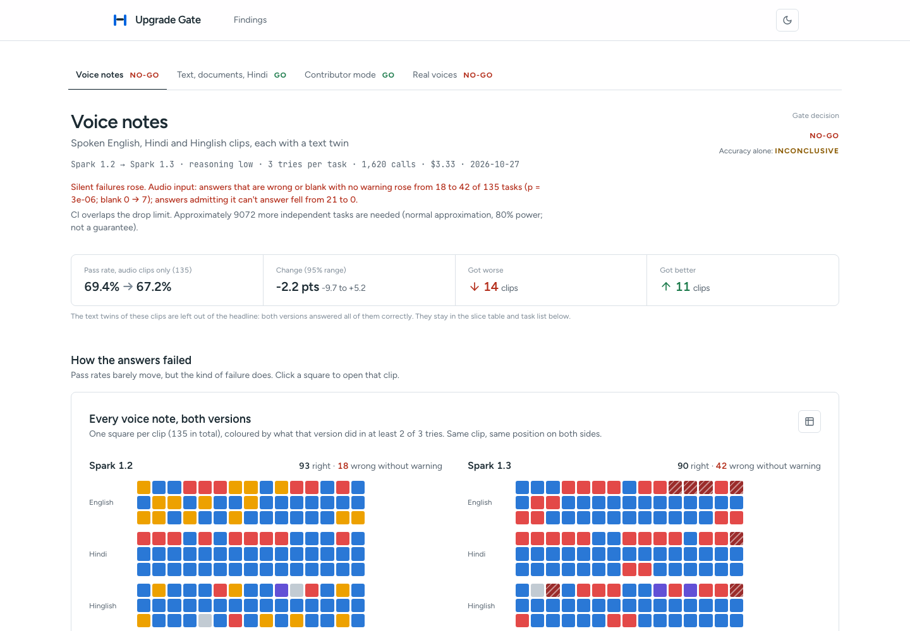
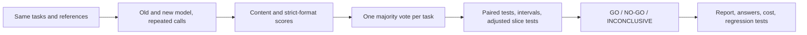

# Upgrade Gate

We replay your tasks on two LLM versions and turn the differences into a GO, NO-GO, or INCONCLUSIVE release decision, with the answers and costs attached.

**Live site:** https://utsavintech.github.io/upgrade-gate/ · **Try the app it protects:** [VoiceOrder](https://utsavintech.github.io/upgrade-gate/#/voiceorder) · **The blocked upgrade:** [PR #1](https://github.com/UtsavInTech/upgrade-gate/pull/1)



## What we found (Meta Muse Spark 1.2 → 1.3, 27 Oct 2026, $19.78 of real API calls)

- **Voice notes:** same accuracy (278 vs 274 of 405 answers), but answers that are **wrong or blank with no warning rose from 18 to 42 of 135 clips** (paired exact test, p = 3 × 10⁻⁶). Spark 1.2 often says "I can't hear the audio"; 1.3 never does, and instead returns wrong digits or empty fields. An accuracy-only gate calls this INCONCLUSIVE. Meta's docs warn that 1.3 audio is "not fully supported".
- **Text, invoices and Hindi (1,325 tasks):** our first scorer reported a significant +1.1 point gain for 1.3. It came from Hindi spelling (`Somwar` vs `Somvar`). With content scoring the change is 0.0.
- **Rerun with a real voice:** 45 lines (15 items × 3 languages) read by one person. Accuracy fell 11 points (95% range −20 to −2), which is why the gate says NO-GO, and blank answers appeared only on 1.3 (0 → 6 clips). The combined wrong-or-blank rise (6 → 13) is borderline when the three language versions of each item are grouped (5 vs 0, p = 0.06), and filled-in wrong answers did not rise.
- **More thinking, worse listening:** on voice clips, Spark 1.3 gets fewer right at every step up in reasoning effort (72.8% at minimal → 58.5% at xhigh, p = 0.0009) while costing 6× more; it increasingly decides it can't hear the clip.
- **Contributor mode:** the same pass/fail as Standard on every one of 1,325 tasks (we compared scores, not answer text), at $0.10 vs $1.80 per 1,000 tasks.
- **Judges:** Spark 1.2 and 1.3 judges, given the reference answer, passed none of ~250 wrong answers from either version. No sign of judge-version bias.

Full account and caveats: [findings/LOG.md](findings/LOG.md).

## The problem

Imagine a support team upgrading its model. English tickets still look good, so the team ships. Hindi requests or invoice extraction get worse without moving the average enough to notice. That is the deployment risk we test for. It is an illustrative scenario, not a regression we found in E1.

We ask both versions the same questions, repeat the calls, and inspect disagreements by workflow, language, and input type. A blocked release comes with the exact cases to reproduce. We also learned to inspect the scorer before trusting its p-value.

## What E1 actually found

We ran **1,325 tasks × two Muse Spark versions × three repeats: 7,950 saved calls, $14.55**. Both versions used low reasoning effort. The first result looked like a Hindi improvement. Reading the answers changed that conclusion.

| Scoring of the same saved answers | 1.3 minus 1.2, paired task pass rate | Exact McNemar p |
|---|---:|---:|
| Before: old scorer | +1.13 points | 0.000061 |
| After: corrected content scoring | 0.00 points | 1.0 |
| Current strict requested format | +0.15 points | 0.5 |

The old scorer rejected correct Hindi spellings such as `Somwar` versus `Somvar`, and some correct answers wrapped in extra text. We separated **correctness** from **requested format** and rescored the saved outputs. We made no new API calls to do that. The headline improvement disappeared. Every corrected content slice has a zero paired delta; E1's content gate is **GO** on this test suite.

The models are near the ceiling here. This does not establish that 1.3 is safe on every company's workload. E1 shows why a statistically significant score difference still needs an audited scoring rule. See the [recorded E1 tables](experiments/out/e1_upgrade.md) and [experiment account](findings/LOG.md#e1-result-spark-12--13-and-a-scorer-that-invented-an-improvement). Raw run folders stay local under `results/` and are not committed.

## The app it protects: VoiceOrder

[`voiceorder/`](voiceorder/server.py) is a small voice-order helper for an Indian online shop. A customer leaves a
voice note in Hindi, Hinglish or English with their order number, pincode and city; Meta Muse Spark turns it into an
order, and the shop's usual format checks run before it's saved. It uses **the model in
[`release/model.json`](release/model.json) and exactly the prompt the gate tests**, so the gate's verdict is about
this app.

On the same Hindi voice note, Spark 1.2 saves pincode `452089` (correct). Spark 1.3 saves `380015`, a real Ahmedabad
pincode, just the wrong one, and the shop's checks pass it. On other notes 1.3 returns every field blank, and the order
is lost. Run it at `#/voiceorder` (`npm --prefix web run dev` starts the app and its API). Sample notes reuse saved
answers ($0); a fresh recording costs about $0.01 and isn't stored.

## Watch it block an upgrade

[`release/model.json`](release/model.json) holds the model this app ships. The branch
[`upgrade/spark-1.3`](https://github.com/UtsavInTech/upgrade-gate/compare/main...upgrade/spark-1.3) changes it from
`spark-1.2@low` to `spark-1.3@low`. On that pull request, [the upgrade-gate workflow](.github/workflows/upgrade-gate.yml)
replays the saved answers in [`evidence/`](evidence) for both models (no API key needed) and runs three checks:

| Check | Result | Why |
|---|---|---|
| `upgrade-gate / voice-notes` | ❌ NO-GO | Audio input: wrong or blank with no warning 18 → 42 of 135 clips, p = 3 × 10⁻⁶. Accuracy alone: inconclusive |
| `upgrade-gate / real-voices` | ❌ NO-GO | 6 → 13 of 45 clips read by a person, and accuracy down past the limit |
| `upgrade-gate / text-and-documents` | ✅ GO | No change on 1,325 tasks |
| `deploy model` | skipped | Runs only when every check passes |

Each failed check's summary shows one filled-in wrong answer, e.g. a Hindi voice note where 1.3 returns pincode
`380015` (a real Ahmedabad pincode) instead of `452089`: correctly shaped, so a required-fields check passes it. With
branch protection requiring these checks, GitHub also blocks the merge. In a live setup the same step runs
`upgrade-gate all` with `MODEL_API_KEY` instead of replaying saved answers.

## Use it in your repo

Add the Action to any workflow that runs on a model change. Replay mode gates saved, scored answers; live mode runs a
small fresh sample on both models with a strict spending cap (an inconclusive small sample doesn't fail the check;
a NO-GO does).

```yaml
- uses: UtsavInTech/upgrade-gate@main
  with:
    baseline: spark-1.2@low
    candidate: spark-1.3@low
    mode: live                      # or: replay, with evidence: path/to/saved-run
    tasks: my_tasks.jsonl           # your own tasks (docs/BRING_YOUR_OWN_TASKS.md) or a built-in pack
    n: "20"
    budget: "1"                     # USD, reserved per call before it is sent
    policy: release/policy.json     # what counts as a harmful failure, and why
    api-key: ${{ secrets.MODEL_API_KEY }}
```

This repo's own [workflow](.github/workflows/upgrade-gate.yml) uses it (`uses: ./`) for its live-sample check.

## Try it without spending money

```sh
npm --prefix web install
npm --prefix web run dev     # http://127.0.0.1:5191
```

- `#/` — the findings.
- `#/report/e6-audio` (also `e1-upgrade`, `e3-contributor`) — the report: gate verdict, slices with 95% ranges, every task with both versions' answers, audio and documents, filters and search.
- `#/record` — record the voice-note lines in a real voice for the confirmation run (E7).

The site reads exported data committed under `web/public`, so it makes no model calls. To refresh it from your own runs: `npm --prefix web run data`. To run the pipeline itself: `python3 -m venv .venv && .venv/bin/pip install -e '.[dev]'`, add `MODEL_API_KEY` to `.env`, then `.venv/bin/upgrade-gate check`.

## How it works



The gate uses exact McNemar tests on task disagreements, paired bootstrap confidence intervals, and Holm correction across category, language, and modality slices. Ties fail; unscored repeats are excluded. The dashboard's intersection heatmap is a separate exploratory view. Repeat disagreement is shown as context, not used as a delta threshold. [Methods and tradeoffs](docs/DECISIONS.md).

A saved, scored run takes three lines to gate and review:

```sh
.venv/bin/upgrade-gate gate "$RUN_DIR"
.venv/bin/upgrade-gate report "$RUN_DIR"
.venv/bin/upgrade-gate export "$RUN_DIR"
```

The gate exits **0 for GO, 2 for NO-GO, 3 for INCONCLUSIVE**. Other failures also exit nonzero. A company can supply its scored run as an artifact in GitHub Actions and stop deployment on any nonzero result:

```yaml
# RUN_DIR must contain run.json, tasks.jsonl, responses.jsonl, and scores.jsonl.
- uses: actions/setup-python@v5
  with:
    python-version: '3.11'
- run: pip install -e '.[dev]'
- name: Gate the saved candidate run
  id: gate
  env:
    RUN_DIR: results/release-candidate
  run: upgrade-gate gate "$RUN_DIR"  # 0=GO; 2=NO-GO; 3=INCONCLUSIVE
- name: Write the review report, even when blocked
  if: always() && steps.gate.outcome != 'skipped'
  run: upgrade-gate report results/release-candidate
- name: Deploy only after GO
  if: success() && steps.gate.outcome == 'success'
  run: ./deploy.sh  # replace with your deployment command
```

Supply the run artifact before this snippet. It does not collect paid model responses. Exported pytest checks need a `call_model(prompt)` fixture; image-aware fixtures must send the preserved attachments. Promptfoo users supply a provider. Exports use deterministic reference checks, which can be stricter than a task's lenient content scorer; review them before using them as release policy.

## What is Meta-specific

We use the Meta Model API directly and pin Muse Spark IDs in each run's metadata. E1 compares `muse-spark-1.2` with `muse-spark-1.3`, both at `reasoning_effort=low`.

The experiment code also compares **Standard versus Contributor mode**, tests the reasoning-effort ladder, and can use **Muse Wonder** as a blind judge. A hosted **Muse Spark Open** adapter is available for an open-weights judge. Those are supported experiment paths, not results we claim from E1. New E2–E4 results appear when their saved records land. The dashboard labels serving-mode repricing as an estimate at recorded token usage; price estimates alone do not demonstrate equal quality. API and pricing notes are the repo's [Oct 27 snapshot](docs/META_API.md).

Every paid call reserves worst-case cost before sending. Our local default lifetime limit is **$90**, with a **$100 hard ceiling**, and **$15 set aside for the canary** inside that limit. `upgrade-gate spend` reads the ledger without making calls. Keep `.spend/ledger.jsonl` when resuming work. Contributor mode belongs only in a workflow whose data policy permits it.

## Limits we would want a release owner to read

- E1 uses single-turn tasks and easy packs. English is at the ceiling; passing them does not establish agent, tool-use, or production reliability.
- A correct answer and an answer in the required format are different contracts. Saved scorer rules and their details remain inspectable. Accepting spelling variants can also over-accept; audit examples.
- Bootstrap intervals describe observed task pairs. A zero-width interval with no discordant pairs does not prove zero risk. Matched translations can be correlated; the current intervals treat tasks as independent.
- The main gate is a fixed-horizon test. Its intervals should not be repeatedly peeked at as though they were anytime-valid. The separate sequential test is not wired into the runner by this dashboard.
- Heatmap cells with too little evidence stay grey. A GO covers the tested gate slices and margin, not every untested population.
- Judges can be biased. Open-weights and judge-version paths need their own measured results; they are not substitutes for known-answer checks.
- Static builds contain prompts, raw answers, and attachments. Share only runs you intend to distribute. `results/` remains gitignored.

## How we built it

Utsav designed the study and ran the experiments. Claude Code and Codex helped write code. All reported experimental results come from real API runs; the offline demo fixture is synthetic and labeled. We keep the false start: the old scorer's “improvement” is part of the evidence, not a result we quietly replaced.

We tried an OpenRouter route, then removed it and used Meta directly. Our first 200-token check left 1.1 and 1.3 with empty visible answers because reasoning consumed the budget. We raised the check limit and kept that failure in the record. Ten concrete choices, including these dead ends, are in [docs/DECISIONS.md](docs/DECISIONS.md).

[Study notes](findings/LOG.md) · [Code ownership and record shapes](docs/CONTRACT.md) · [Research plan](RESEARCH_GUIDE.md)
